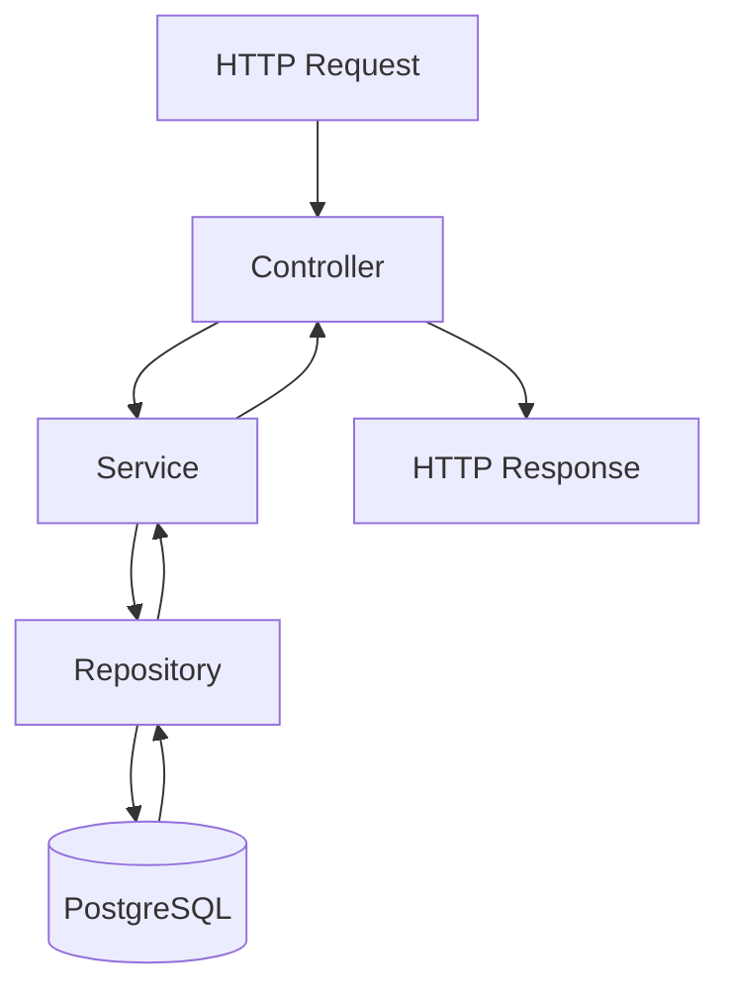

# ACME Salary Management System: Architecture

> **Status:** Living design document. Update this file as the architecture and implementation evolve.
>
> - **Pending:** Work has not started or is not yet implemented.
> - **In Progress:** Work is underway, or implementation and verification remain incomplete.
> - **Implemented:** The relevant code or configuration exists.
> - **Verified:** The relevant tests or checks have been run and passed.

## 1. Purpose

Enable ACME's HR Manager to manage employee records, maintain salary history, and generate currency-aware reports across countries and departments for approximately 10,000 employees.

The system replaces spreadsheet-based salary management with a centralised web application that supports reliable data management, secure access, and reporting.

## 2. Architecture Style

**Style: Modular monolith**

The application is built as a single Spring Boot application divided into business modules with clear responsibilities and boundaries.

This approach was chosen over microservices to simplify deployment, testing, and demonstration while keeping the codebase organised for future development.

**Status:** Implemented as the architectural approach. Module implementation remains ongoing.

## 3. Technology Stack

| Layer | Technology | Status |
|---|---|---|
| Backend language | Java 21 LTS | Implemented |
| Backend framework | Spring Boot 4.1.1 | Implemented |
| Database | PostgreSQL 17 | Implemented |
| Database migrations | Flyway | Implemented: V1, V2, V3 |
| Data access | Spring Data JPA and Hibernate | Implemented |
| Validation | Jakarta Bean Validation | Implemented |
| Security | Spring Security; JWT planned | In Progress |
| Testing | JUnit 5, Spring Boot Test, MockMvc | Implemented; 61 tests reported passing |
| Configuration | `springboot4-dotenv` and profile-specific properties | Implemented |
| Frontend | Angular | Pending |
| Containerisation | Docker and Docker Compose | Pending |
| Version control | Git and GitHub | Implemented |

> **Version note:** Confirm the Spring Boot version against `backend/pom.xml` and the PostgreSQL version against the actual database environment before submission.

## 4. Backend Modules

### 4.1 Employee Module

**Responsibilities**

- Create and retrieve employee profiles.
- List employees in a directory.
- Support search, filtering, pagination, and sorting.
- Validate employee data and handle duplicate or missing records.

**Implemented components**

- `Employee.java`
- `EmployeeRepository.java`: extends `JpaRepository` and `JpaSpecificationExecutor`.
- `EmployeeService.java`: supports filtered and unfiltered employee listing.
- `EmployeeController.java`: exposes create, get-by-ID, and searchable, filterable, paginated list endpoints, including parameter validation and sort-field whitelisting.
- `EmployeeSearchCriteria.java`: carries search and filter values from the controller to the service.
- `EmployeeSpecifications.java`: provides composable JPA specifications for search and filtering.
- `EmploymentStatus.java`
- `EmployeeRequest.java` and `EmployeeResponse.java`
- `V1__create_employees.sql`

**Status:** Implemented and verified, according to the recorded test and Postman results.

Employee creation, retrieval by ID, listing, search, filtering, pagination, sorting, sort-field validation, and parameter validation are covered by the controller, service, and specifications test suites and Postman smoke tests.

### 4.2 Salary Module

**Responsibilities**

- Record salary changes as append-only history.
- Preserve previous salary records when a new salary takes effect.
- Resolve the current salary as the latest record whose effective date is on or before today.
- Validate currency codes and reject unknown ISO 4217 values.
- Expose endpoints nested under the employee to whom the salary belongs.

**Implemented components**

- `SalaryRecord.java`: JPA entity without setters for `amount`, `currencyCode`, `effectiveDate`, or `employee`.
- `SalaryRecordRepository.java`: derived queries for current-salary resolution, existence checks, and paginated listing.
- `SalaryRecordService.java`: applies business rules, including employee-existence checks, positive salary amounts, a future-date limit of 10 years, currency validation using `java.util.Currency`, duplicate-effective-date detection, sort-field validation, and page-size limits.
- `SalaryRecordController.java`: exposes the salary endpoints listed below.
- `SalaryRecordRequest.java`
- `SalaryRecordResponse.java`
- `CurrentSalaryResponse.java`
- `V2__create_salary_records.sql`
- `V3__alter_salary_records_currency_code.sql`
- `DuplicateSalaryException.java`
- `InvalidCurrencyException.java`

**API endpoints**

| Method | Endpoint | Purpose |
|---|---|---|
| `POST` | `/api/employees/{employeeId}/salaries` | Create a salary record |
| `GET` | `/api/employees/{employeeId}/salaries` | Retrieve salary history |
| `GET` | `/api/employees/{employeeId}/salaries/current` | Retrieve the current salary |

**Append-only guarantee**

The design enforces salary history preservation at three levels:

1. **Database:** `UNIQUE (employee_id, effective_date)` prevents multiple salary records for the same employee and effective date. `ON DELETE RESTRICT` prevents deleting an employee while referenced salary records exist.
2. **Entity:** Setters for the salary fields that should not change are not exposed.
3. **Service:** There are no salary update or delete methods. A salary change is recorded as a new insert.

**Current-salary resolution**

The repository uses the following derived query to retrieve the latest salary record effective on or before the current date:

```java
findTopByEmployeeIdAndEffectiveDateLessThanEqualOrderByEffectiveDateDesc(
    employeeId,
    LocalDate.now()
)
```

The `idx_salary_records_employee_effective_desc` index supports current-salary lookup and salary-history queries.

**Status:** Implemented and verified, according to the recorded test and Postman results.

The recorded coverage includes salary creation, listing, current-salary retrieval, duplicate detection, invalid currency rejection, oversized page requests, and missing-employee scenarios.

Reported test counts:

- `SalaryRecordControllerTest`: 10 tests
- `SalaryRecordRepositoryTest`: 6 tests
- `SalaryRecordServiceTest`: 12 tests

### 4.3 Reporting Module

**Responsibilities**

- Provide dashboard statistics.
- Generate salary reports grouped by currency, country, and department.
- Support report filtering and future CSV export.

**Status:** Pending.

### 4.4 Security Module

**Responsibilities**

- Implement JWT authentication.
- Enforce endpoint-level authorisation.
- Protect employee and salary data against unauthorised access.

**Current state**

Spring Security is included in the application. The development-only `DevSecurityConfig`, guarded by `@Profile("dev")`, disables CSRF and permits requests when the development profile is explicitly activated. This configuration supports local API testing through Postman or a browser.

When the development profile is not active, the application's effective security behaviour depends on its other Spring Security configuration and defaults. Production-grade authentication has not yet been implemented.

**Pending work**

- Production-ready JWT authentication.
- Token validation and authentication filters.
- Endpoint authorisation rules.
- Security tests for unauthenticated and unauthorised requests.

**Status:** In Progress.

> **Security warning:** The development configuration must not be used in production. Before deployment, verify that the `dev` profile is activated only when intended and that protected endpoints enforce appropriate authentication and authorisation.

### 4.5 Common Module

**Responsibilities**

Provides shared API error responses, exception handling, and web configuration.

**Implemented components**

- `ApiErrorResponse.java`: shared error response structure.
- `GlobalExceptionHandler.java`: centralised exception handling.
- `DuplicateEmployeeException.java`: employee conflict handling.
- `DuplicateSalaryException.java`: salary conflict handling.
- `InvalidCurrencyException.java`: invalid currency handling.
- `EmployeeNotFoundException.java`: employee not-found handling.
- `WebConfig.java`: enables `@EnableSpringDataWebSupport(pageSerializationMode = VIA_DTO)` for stable paginated response serialisation.
- `DevSecurityConfig.java`: development-profile security configuration.

The global exception handler maps the following exceptions:

| Exception or category | HTTP status |
|---|---:|
| `MethodArgumentNotValidException` | 400 |
| `ConstraintViolationException` | 400 |
| `MethodArgumentTypeMismatchException` | 400 |
| `IllegalArgumentException` | 400 |
| `InvalidCurrencyException` | 400 |
| `DuplicateEmployeeException` | 409 |
| `DuplicateSalaryException` | 409 |
| `EmployeeNotFoundException` | 404 |

These mappings use the shared API error response structure.

**Status:** Implemented.

## 5. Request Flow

The backend follows a layered request-processing flow.



**Layer responsibilities**

- **Controller:** Handles HTTP requests, path and query parameters, input validation, sort-field whitelisting, and response status codes.
- **Service:** Applies business rules, coordinates operations, and maps entities to response DTOs.
- **Repository:** Uses Spring Data JPA, including `JpaRepository` and `JpaSpecificationExecutor`, to query and persist data.
- **PostgreSQL:** Stores application data in a relational database.

## 6. Employee Search, Filtering, Pagination, and Sorting

The employee directory supports the following functionality.

### Search and filters

- **Free-text search:** Case-insensitive partial matching across first name, last name, employee number, and email.
- **Country filter:** Exact country-code matching.
- **Department filter:** Exact department matching.
- **Employment-status filter:** Enum validation against supported employment statuses.
- **Combined criteria:** Search and filters can be applied in a single request.

The free-text search matches any of the four searchable fields using OR conditions. The search criteria are combined with other filters using AND conditions.

### Pagination and sorting

- Server-side pagination.
- Validated page and page-size parameters.
- Non-negative page numbers.
- Page size capped at 100.
- Sort-field whitelist using `EmployeeController.SORTABLE_FIELDS`.
- Unsupported sort fields return HTTP 400.

### Implementation approach

Spring Data JPA specifications are combined with `Pageable`. Each filter is represented by a small, testable specification. The resulting specification and pagination settings are passed to `JpaSpecificationExecutor.findAll(spec, pageable)`, so filtering and pagination execute at the database level.

When no search or filter criteria are supplied, the service falls back to `findAll(pageable)` rather than passing a null specification into the specification-based query method.

**Status:** Implemented and verified, according to the recorded test and Postman results.

Relevant tests include `EmployeeSpecificationsTest` for specification-level behaviour and `EmployeeControllerTest` for HTTP-level behaviour.

## 7. Data Model

### 7.1 Employee Table

**Migration:** `V1__create_employees.sql`

The `employees` table contains the following columns:

| Column | Description |
|---|---|
| `id` | `BIGSERIAL` primary key |
| `employee_number` | Unique employee identifier |
| `first_name` | Employee's first name |
| `last_name` | Employee's last name |
| `email` | Unique email address |
| `country_code` | Two-letter country code, validated against `^[A-Z]{2}$` |
| `department` | Employee's department |
| `employment_status` | Employment status constrained to permitted values |
| `created_at` | Creation timestamp |
| `updated_at` | Last-update timestamp |

Both timestamp columns use `TIMESTAMPTZ`.

Indexes support queries involving last name, country code, department, employment status, and lowercased first- and last-name expressions used for search.

### 7.2 Salary Records Table

**Migrations:**

- `V2__create_salary_records.sql`
- `V3__alter_salary_records_currency_code.sql`

The `salary_records` table contains the following columns:

| Column | Description |
|---|---|
| `id` | `BIGSERIAL` primary key |
| `employee_id` | `BIGINT NOT NULL`, referencing `employees(id)` with `ON DELETE RESTRICT` |
| `amount` | `NUMERIC(15,2) NOT NULL`, with a positive-value constraint |
| `currency_code` | `VARCHAR(3) NOT NULL`, validated against `^[A-Z]{3}$` in the database and against ISO 4217 currency codes in the application |
| `effective_date` | `DATE NOT NULL` |
| `created_at` | `TIMESTAMPTZ NOT NULL DEFAULT now()` |

**Database constraints**

- `UNIQUE (employee_id, effective_date)`: one salary record per employee per effective date.
- `CHECK (amount > 0)`: prevents zero or negative salary amounts.
- `CHECK (currency_code ~ '^[A-Z]{3}$')`: requires three uppercase letters.

The `idx_salary_records_employee_effective_desc` index on `(employee_id, effective_date DESC)` supports current-salary lookup and salary-history listing.

**Currency column correction**

The original V2 migration declared `currency_code` as `CHAR(3)`. PostgreSQL stores this as a fixed-width `bpchar` type, which caused a mismatch with Hibernate's expected `VARCHAR(3)` mapping under `ddl-auto=validate`.

V3 changes the column to `VARCHAR(3)` using an explicit `USING` cast. The existing pattern constraint remains in force.

The correction was introduced through a new migration rather than editing V2, following the immutable-migration rule documented in `docs/design-decisions.md`.

**Status:** Employee and salary schemas are implemented. Salary-history preservation is designed to be enforced at the database, entity, and service levels.

### 7.3 Salary History Semantics

Salary history is append-only. Each salary change creates a new row with its own `effective_date`. Application code does not update or delete previous salary records.

The current salary is the record with the latest `effective_date` on or before today. Future-dated records remain visible in the history list but are not treated as the current salary.

## 8. Schema Management

Flyway manages versioned database migrations. Hibernate is configured with `ddl-auto=validate`, so it validates entity mappings against the managed schema instead of creating or altering tables automatically.

**Migration rule:** Applied migrations are immutable. Schema changes must be introduced through new migration versions.

This rule was followed when the salary currency column was corrected in V3 rather than by editing the original V2 migration.

**Current status**

| Item | Status |
|---|---|
| Flyway integration | Implemented |
| Employee schema migration | Implemented |
| Salary records schema migration | Implemented |
| Currency-code column type correction | Implemented |
| Hibernate schema validation | Configured; verification should be supported by the latest test results |

**Migration files**

```text
backend/src/main/resources/db/migration/
├── V1__create_employees.sql
├── V2__create_salary_records.sql
└── V3__alter_salary_records_currency_code.sql
```

## 9. Reporting and Currency

Salary reports must not add amounts expressed in different currencies as though they were equivalent.

The initial reporting approach is to group salary results by currency. Cross-currency totals may be introduced later only when an explicit foreign-exchange conversion methodology is defined.

That methodology must specify:

- Exchange-rate source.
- Exchange-rate date.
- Conversion methodology.
- Rounding rules.
- Treatment of missing exchange rates.

**Status:** Pending.

The data model already stores a currency code for each salary record, allowing future reports to group values by currency without requiring a schema change.

## 10. Security and Privacy

JWT-based authentication and authorisation are planned to protect employee and salary endpoints.

### Security requirements

- Store credentials and secrets in environment variables or an appropriate secrets manager.
- Never commit real database passwords, JWT signing secrets, or other credentials.
- Use synthetic employee and salary data for development, testing, and demonstrations.
- Restrict sensitive operations according to the user's role.
- Avoid exposing internal exceptions, secrets, or sensitive employee information in API responses and logs.

### Current security state

Spring Security's default auto-configuration may provide an in-memory user and generate a password at startup when no alternative configuration overrides it.

`DevSecurityConfig`, guarded by `@Profile("dev")`, disables CSRF and permits requests when the development profile is explicitly activated. This configuration is intended only for local API testing and must not be treated as production security.

### Configuration mechanism

Local configuration is loaded from `backend/.env` using the `springboot4-dotenv` library.

- Local development uses `SPRING_PROFILES_ACTIVE=dev`.
- Production must set `SPRING_PROFILES_ACTIVE=prod` through the hosting environment.
- Production secrets must be configured through the hosting platform or an appropriate secrets manager.
- The local `.env` file must not be committed.

**Status:** In Progress. JWT authentication, authorisation, and security verification remain pending.

## 11. Scalability and Performance

The application is designed to support approximately 10,000 employee records.

Current performance-related measures include:

- Server-side pagination for employee and salary listings.
- A maximum page size of 100.
- Database indexes supporting selected search and filtering operations.
- An index supporting current-salary resolution and salary-history queries.

Employee search uses `LOWER(column) LIKE '%term%'` rather than PostgreSQL full-text search.

For the target dataset, this is the chosen initial approach. Whether it performs adequately must be confirmed with representative data and measurements. A `pg_trgm` GIN index is a potential follow-up if testing demonstrates that substring searches need optimisation.

This trade-off is documented in `docs/design-decisions.md`.

Performance claims must be supported by measurements rather than assumptions. Load testing and response-time measurements should be performed after representative seed data is available.

**Status:** In Progress.

## 12. Containerisation

The planned containerisation setup includes:

| Component | Purpose | Status |
|---|---|---|
| `backend/Dockerfile` | Multi-stage build with a slim Java runtime image | Pending |
| `frontend/Dockerfile` | Angular build stage and Nginx runtime | Pending |
| `docker-compose.yml` | Orchestrates PostgreSQL, backend, and frontend | Pending |
| `.env.docker.example` | Optional template for container-based development | Pending; subject to adoption |

Real credentials and secrets must remain outside version control.

**Status:** Pending. Containerisation will follow the core application features.

## 13. Testing Strategy

### 13.1 Unit Tests

Service-level tests cover business rules, including validation, duplicate handling, not-found scenarios, and the criteria-to-specification handoff.

| Test class | Reported test count |
|---|---:|
| `EmployeeServiceTest.java` | 8 |
| `SalaryRecordServiceTest.java` | 12 |

**Status:** Implemented and verified, according to the recorded test results.

### 13.2 Web-Layer Tests

Controller tests use MockMvc to cover request validation, response status codes, error responses, pagination, search and filter parameter binding, invalid parameters, nested-path parameters, and request-body deserialisation.

| Test class | Reported test count |
|---|---:|
| `EmployeeControllerTest.java` | 10 |
| `SalaryRecordControllerTest.java` | 10 |

Both use `@WebMvcTest` and `@AutoConfigureMockMvc(addFilters = false)` so security filters do not interfere with controller-behaviour assertions.

Security behaviour must be tested separately in the security milestone.

**Status:** Implemented and verified, according to the recorded test results.

### 13.3 Repository and Integration Tests

Persistence tests use PostgreSQL to validate behaviour against the target database engine rather than H2.

Test methods use `@Transactional` for rollback and generate unique identifiers to reduce collisions with manually created data or previous runs.

| Test class | Reported test count |
|---|---:|
| `EmployeeRepositoryTest.java` | 5 |
| `EmployeeSpecificationsTest.java` | 9 |
| `SalaryRecordRepositoryTest.java` | 6 |

**Status:** Implemented and verified, according to the recorded test results.

### 13.4 Frontend Tests

Angular component and service tests will be added after the frontend is implemented.

**Status:** Pending.

### 13.5 API and End-to-End Tests

The Postman collection is maintained at:

`docs/postman/acme-salary-management.postman_collection.json`

It supports manual API verification and should be updated as endpoints, request schemas, or response contracts evolve.

The collection covers:

- Employee creation and retrieval.
- Employee listing, search, filtering, sorting, and pagination.
- Employee validation errors.
- Salary creation, history listing, and current-salary retrieval.
- Duplicate effective dates.
- Invalid currency codes.
- Missing employees.
- Oversized page requests.

**Status:** Collection present; the recorded results indicate that it has been exercised against a running application.

### 13.6 Reported Test Summary

The recorded test result is **61 passing tests, with 0 failures, 0 errors, and 0 skipped**, across eight test classes.

| Test class | Reported tests |
|---|---:|
| `EmployeeControllerTest` | 10 |
| `EmployeeRepositoryTest` | 5 |
| `EmployeeServiceTest` | 8 |
| `EmployeeSpecificationsTest` | 9 |
| `SalaryRecordControllerTest` | 10 |
| `SalaryRecordRepositoryTest` | 6 |
| `SalaryRecordServiceTest` | 12 |
| `SalaryManagementApplicationTests` | 1 |
| **Total** | **61** |

> **Verification note:** Treat these as the recorded results until the full test suite is run again. Update this table using the actual output of the latest test run.

## 14. Synthetic Data

The `scripts/` directory is intended to contain a repeatable data generator for 10,000 fictional employees and their associated salary records.

The generator should:

- Use a deterministic random seed for reproducible results.
- Produce valid employee numbers, emails, country codes, departments, and employment statuses.
- Generate salary records with appropriate amounts, currencies, and effective dates.
- Avoid using real personal information.
- Support repeatable development and performance testing.

**Status:** Pending.

## 15. Deployment

Planned deployment options include:

- Hosting the backend and PostgreSQL through suitable managed services, such as Render and Neon.
- Hosting the frontend through a service such as Vercel or Netlify.
- Deploying through Docker Compose on a suitably configured server.

Once deployment has been implemented, `README.md` should document the selected approach, environment variables, database migrations, security configuration, and run instructions.

**Status:** Pending.

## 16. Implementation and Verification Rules

To keep this document accurate throughout development:

1. Mark a component as **Implemented** only when the corresponding code or configuration exists.
2. Mark functionality as **Verified** only after the relevant test or check has passed.
3. Record pending work honestly. Planned functionality must not be described as completed.
4. Update this document in the same commit as significant architecture or implementation changes.
5. Re-run relevant tests after changes and update test counts and verification claims using actual results.
6. Never commit real credentials, secrets, or personal employee data.

This document is a living record of the architecture, implementation progress, and verification evidence for the ACME Salary Management System.