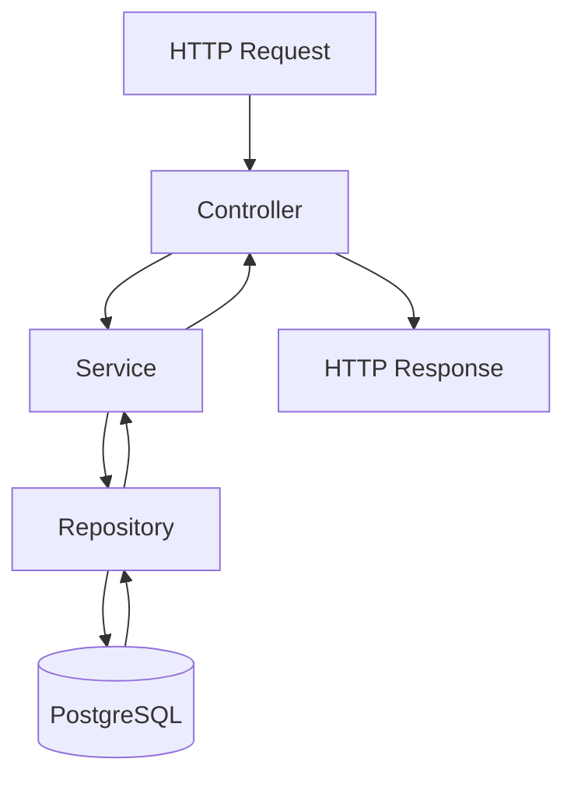

# ACME Salary Management System — Architecture

> **Status:** Living design document. Each section tracks implementation progress. `Pending` means work has not started or is not yet implemented. `In Progress` means work is underway. `Implemented` means the code or configuration exists. `Verified` means the relevant tests or checks have been run and passed.

## 1. Purpose

Enable ACME's HR Manager to manage employee records, maintain salary history, and generate currency-aware reports across countries and departments for 10,000 employees.

The system replaces spreadsheet-based salary management with a centralised web application that supports reliable data management, secure access, and reporting.

## 2. Architecture Style

**Modular monolith.**

The application is built as a single Spring Boot application divided into business modules with clear responsibilities and boundaries.

This approach was chosen over microservices to simplify deployment, testing, and demonstration while keeping the codebase organised for future development.

**Status:** Implemented as the architectural approach. Module implementation remains ongoing.

## 3. Technology Stack

| Layer | Technology | Status |
|---|---|---|
| Backend language | Java 21 LTS | Implemented |
| Backend framework | Spring Boot 4.1.1 | Implemented |
| Database | PostgreSQL 17 | Implemented |
| Database migrations | Flyway | Implemented |
| Data access | Spring Data JPA and Hibernate | Implemented |
| Validation | Jakarta Bean Validation | Implemented |
| Security | Spring Security; JWT planned | In Progress |
| Testing | JUnit 5, Spring Boot Test, MockMvc | Implemented; reported tests passing |
| Frontend | Angular | Pending |
| Containerisation | Docker and Docker Compose | Pending |
| Version control | Git and GitHub | Implemented |

> **Version note:** Confirm the Spring Boot version against `backend/pom.xml` and the PostgreSQL version against the actual database environment before submission.

## 4. Backend Modules

### 4.1 Employee Module

**Responsibilities**

- Create and retrieve employee profiles.
- List employees in a directory.
- Support search, filtering, pagination, and sorting.
- Validate employee data and handle duplicate or missing records.

**Implemented components**

- `Employee.java`
- `EmployeeRepository.java`
- `EmployeeService.java`
- `EmployeeController.java`
- `EmploymentStatus.java`
- `EmployeeRequest.java`
- `EmployeeResponse.java`
- `V1__create_employees.sql`
- Employee validation and shared error handling.

**Pending**

- `EmployeeSpecifications.java`
- Database-backed search and filtering using Spring Data JPA specifications.

**Status:** Core employee CRUD and pagination are implemented. Verify each feature against the current test results and API behaviour.

### 4.2 Salary Module

**Responsibilities**

- Manage salary amounts and currencies.
- Record salary effective dates.
- Maintain append-only salary history.
- Preserve previous salary records when a new salary takes effect.

**Status:** Pending.

### 4.3 Reporting Module

**Responsibilities**

- Provide dashboard statistics.
- Generate salary reports grouped by currency, country, and department.
- Support report filtering and future CSV export.

**Status:** Pending.

### 4.4 Security Module

**Responsibilities**

- Implement JWT authentication.
- Enforce endpoint-level authorisation.
- Protect employee and salary data against unauthorised access.

**Current state**

Spring Security is included in the application. A development-only `DevSecurityConfig` is available under the `dev` profile to support local API testing through Postman or a browser.

When the development profile is not active, the application's effective security behaviour depends on its other Spring Security configuration and defaults.

**Pending**

- Production-ready JWT authentication.
- Token validation and authentication filters.
- Endpoint authorisation rules.
- Security tests covering unauthenticated and unauthorised requests.

**Status:** In Progress.

> **Security warning:** The development configuration must not be used in production. Confirm that the `dev` profile is activated only when intended and that protected endpoints require appropriate authentication before deployment.

### 4.5 Common Module

**Responsibilities**

Provides shared error responses, exception handling, and web configuration.

**Implemented components**

- `ApiErrorResponse.java`
- `GlobalExceptionHandler.java`
- `EmployeeNotFoundException.java`
- `WebConfig.java`
- `DevSecurityConfig.java` — development profile configuration.

**Status:** Implemented. Verify shared error handling and pagination serialisation through automated tests.

## 5. Request Flow

The backend follows a layered request-processing flow.

- **Controller:** Handles HTTP requests, request parameters, input validation, and response status codes.
- **Service:** Applies business rules, coordinates operations, and maps entities to response DTOs.
- **Repository:** Uses Spring Data JPA to query and persist data.
- **PostgreSQL:** Stores application data in a relational database.

## 6. Employee Search, Filtering, Pagination, and Sorting

The employee directory is designed to support:

- Case-insensitive partial searches across first name, last name, employee number, and email.
- Filters by country code, department, and employment status.
- Combined search and filtering in a single request.
- Server-side pagination and sorting with parameter validation.

### Implementation approach

Spring Data JPA `Specification` predicates will be combined with `Pageable` to perform filtering and pagination at the database level. This avoids loading the entire employee directory into application memory for each request.

**Current status**

- Pagination and sorting: Implemented; verify the supported sort fields and limits.
- Search and filtering: Pending until the specification logic and corresponding tests are complete.
- End-to-end API verification: Record the results of actual Postman requests in the project test evidence or AI work log.

## 7. Data Model

### 7.1 Employee Table

Implemented through `V1__create_employees.sql`.

The `employees` table contains:

- `id` — `BIGSERIAL` primary key.
- `employee_number` — unique employee identifier.
- `first_name` — employee's first name.
- `last_name` — employee's last name.
- `email` — unique email address.
- `country_code` — two-letter country code, validated against the configured format.
- `department` — employee's department.
- `employment_status` — employment status constrained to permitted values.
- `created_at` — creation timestamp.
- `updated_at` — last-update timestamp.

Both timestamps use `TIMESTAMPTZ`.

Indexes are defined for `last_name`, `country_code`, `department`, `employment_status`, and the lowercased first and last name expressions used for search.

### 7.2 Salary Records Table

Planned for `V2__create_salary_records.sql`.

The proposed `salary_records` table will contain:

- `id` — primary key.
- `employee_id` — foreign key referencing the employee.
- `amount` — salary amount using an appropriate numeric type.
- `currency_code` — three-letter currency code following ISO 4217.
- `effective_date` — date on which the salary becomes effective.
- `created_at` — record creation timestamp.

Salary history will be append-only at the application level. Changes to salary should create a new record rather than overwrite a previous salary record.

**Status:** Employee schema implemented; salary records pending.

## 8. Schema Management

Flyway manages versioned database migrations. Hibernate is configured with `ddl-auto=validate`, so it validates the entity mappings against the managed schema rather than creating or altering database tables.

Applied migrations should be treated as immutable. Schema changes must be introduced through new migration versions.

**Current status**

- Flyway integration: Implemented.
- Employee schema migration: Implemented.
- Hibernate schema validation: Configured.
- Verification: Confirm through successful application startup and the relevant automated tests.

The initial employee migration is stored at:

`backend/src/main/resources/db/migration/V1__create_employees.sql`

## 9. Reporting and Currency

Salary reports must not add amounts expressed in different currencies as though they were equivalent.

Version 1 will group salary results by currency. Cross-currency totals may be introduced later only when an explicit foreign exchange conversion methodology is defined, including:

- Exchange-rate source.
- Exchange-rate date.
- Conversion methodology.
- Rounding rules and treatment of missing rates.

**Status:** Pending.

## 10. Security and Privacy

JWT-based authentication and authorisation are planned to protect employee and salary endpoints.

Security requirements include:

- Store credentials and secrets in environment variables or an appropriate secrets manager.
- Never commit real database passwords, JWT signing secrets, or other credentials.
- Use synthetic employee and salary data for development, testing, and demonstrations.
- Restrict access to sensitive operations according to the user's role.
- Avoid exposing internal exceptions, secrets, or sensitive employee information in API responses and logs.

### Current security state

Spring Security's default auto-configuration may provide an in-memory user and generate a password at startup when no alternative configuration overrides it.

The `DevSecurityConfig` class, guarded by `@Profile("dev")`, disables CSRF and permits requests when the development profile is explicitly activated.

This configuration is intended only for local API testing and must not be treated as production security.

**Status:** In Progress. JWT authentication, authorisation, and security verification remain pending.

## 11. Scalability and Performance

The application is designed to support approximately 10,000 employee records.

Server-side pagination limits the number of employee records returned in a single request. Database indexes support selected search and filtering operations.

Performance claims must be supported by measurements rather than assumptions. Load testing and response-time measurements will be performed after representative seed data and the required search and reporting features are available.

**Status:** In Progress.

## 12. Containerisation

The planned containerisation setup includes:

- `backend/Dockerfile` — multi-stage build with a slim Java runtime image.
- `frontend/Dockerfile` — Angular build stage and Nginx runtime.
- `docker-compose.yml` — orchestration for PostgreSQL, the backend, and the frontend.
- `.env.docker.example` — optional example configuration for container-based development, if adopted.

Real credentials and secrets must remain outside version control.

**Status:** Pending. Containerisation will follow the core application features.

## 13. Testing Strategy

### 13.1 Unit Tests

Test service-level business rules, including validation, duplicate handling, and not-found scenarios.

- `EmployeeServiceTest.java`

**Status:** Implemented. The current test count and results must be confirmed by running the test suite.

### 13.2 Web-Layer Tests

Test controller behaviour using MockMvc, including request validation, response status codes, error responses, pagination, and applicable security behaviour.

- `EmployeeControllerTest.java`

**Status:** Implemented. Confirm that the tests pass against the current security configuration.

### 13.3 Repository and Integration Tests

Test persistence and database behaviour against PostgreSQL. Using PostgreSQL rather than H2 is an intentional choice to validate behaviour against the target database engine.

- `EmployeeRepositoryTest.java`

**Status:** Implemented. Confirm the test database configuration and the latest results.

### 13.4 Frontend Tests

Test Angular components and services once the frontend has been implemented.

**Status:** Pending.

### 13.5 API and End-to-End Tests

The Postman collection is maintained at:

`docs/postman/acme-salary-management.postman_collection.json`

It supports manual API verification and should be updated as endpoints and request or response contracts evolve.

**Status:** Collection present according to the documented repository structure. Verify the requests against the running application.

### Test Summary

The previous project notes reported 16 passing tests across four test classes against PostgreSQL 17.6. This is a historical result, not a guarantee of the current build status.

Run the current test suite and update this summary using the actual results before submission.

## 14. Synthetic Data

The `scripts/` directory is intended to contain a repeatable data generator for 10,000 fictional employees and their associated salary records.

The generator should:

- Use a deterministic random seed for reproducible results.
- Produce valid employee numbers, emails, country codes, departments, and employment statuses.
- Generate salary records with appropriate amounts, currencies, and effective dates.
- Avoid using real personal information.
- Support repeatable development and performance testing.

**Status:** Pending.

## 15. Deployment

The planned deployment options include:

- Backend and PostgreSQL hosted through suitable managed services, such as Render and Neon.
- Frontend hosted through a service such as Vercel or Netlify.
- Alternatively, deployment through Docker Compose on a suitably configured server.

The selected deployment approach, environment variables, database migrations, security configuration, and run instructions will be documented in `README.md` once deployment has been implemented.

**Status:** Pending.

## 16. Implementation and Verification Rules

To keep this document accurate throughout development:

1. Mark a component as **Implemented** only when the corresponding code or configuration exists.
2. Mark functionality as **Verified** only after the relevant test or check has passed.
3. Record pending work honestly; planned functionality must not be described as completed.
4. Update this document in the same commit as significant architecture or implementation changes.
5. Re-run the relevant tests after changes and update test counts and verification claims using actual results.
6. Never commit real credentials, secrets, or personal employee data.

This document is a living record of the architecture, implementation progress, and verification evidence for the ACME Salary Management System.
