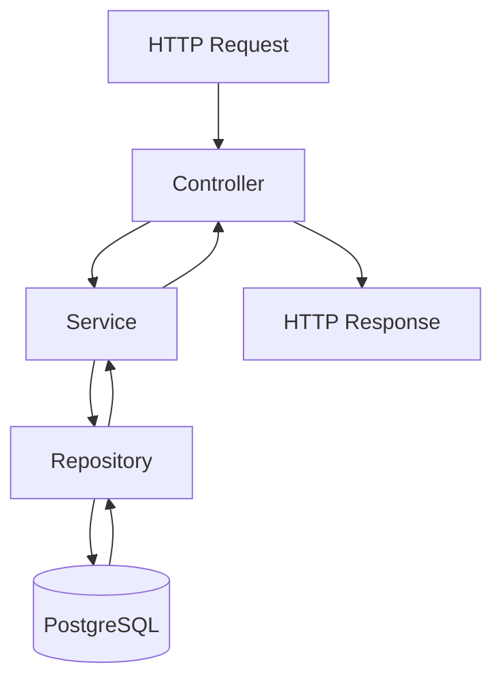

# ACME Salary Management System: Architecture

> **Document status:** Living design document  
> **Architecture style:** Modular monolith  
> **Current focus:** Employee management, database integration, testing, and API validation

This document describes the system architecture, technology stack, backend modules, data model, security approach, testing strategy, and implementation progress.

## Status Definitions

| Status | Meaning |
|---|---|
| **Pending** | Work has not started or has not yet been implemented. |
| **In Progress** | Work is underway, or some parts are implemented while others remain outstanding. |
| **Implemented** | The relevant code or configuration exists. |
| **Verified** | The relevant tests or checks have been run and passed. |

A component should only be marked as **Verified** when supporting test or verification evidence is available.

## 1. Purpose

The ACME Salary Management System is designed to help ACME's HR Manager manage employee records, maintain salary history, and generate currency-aware reports across countries and departments for approximately **10,000 employees**.

The system replaces spreadsheet-based salary management with a centralised web application that aims to provide:

- Reliable employee and salary data management.
- Historical salary records.
- Searchable and filterable employee directories.
- Country-, department-, and currency-aware reporting.
- Secure access to sensitive employee information.
- Consistent data validation and error handling.

## 2. Architecture Style

**Chosen approach: Modular monolith**

The application is being developed as a single Spring Boot application organised into modules with clearly defined responsibilities.

This approach was chosen instead of microservices to simplify development, deployment, testing, and demonstration while keeping the codebase organised for future extension.

The intended modules are:

- **Employee:** Employee profiles, directory, search, and filtering.
- **Salary:** Salary records and salary history.
- **Reporting:** Dashboard statistics and salary reports.
- **Security:** Authentication and authorisation.
- **Common:** Shared exception handling, error responses, and web configuration.

**Status:** The modular monolith is the selected architectural approach. Employee-related functionality and shared backend components are implemented; other modules remain pending.

## 3. Technology Stack

| Layer | Technology | Status |
|---|---|---|
| Backend language | Java 21 LTS | Implemented |
| Backend framework | Spring Boot 4.1.1 | Implemented; confirm against `backend/pom.xml` |
| Database | PostgreSQL 17 | Configured; confirm the actual database version |
| Database migrations | Flyway | Implemented |
| Data access | Spring Data JPA and Hibernate | Implemented |
| Validation | Jakarta Bean Validation | Implemented |
| Security | Spring Security | Included; production authentication remains pending |
| Authentication | JWT | Planned |
| Testing | JUnit 5, Spring Boot Test, MockMvc | Implemented |
| Configuration | `springboot4-dotenv` and profile-specific properties | Implemented |
| Frontend | Angular | Pending |
| Containerisation | Docker and Docker Compose | Pending |
| Version control | Git and GitHub | Implemented |
| API verification | Postman | Collection present |

> **Version note:** Confirm the Spring Boot version in `backend/pom.xml` and the PostgreSQL version in the actual database environment before submission. Keep the test status aligned with the latest test run.

## 4. Backend Modules

### 4.1 Employee Module

**Responsibilities**

- Create and retrieve employee profiles.
- List employees in a directory.
- Search employee records.
- Filter employees by country, department, and employment status.
- Support pagination and sorting.
- Validate employee data.
- Handle duplicate records and missing employees.

**Implemented components**

| Component | Responsibility |
|---|---|
| `Employee.java` | Employee entity mapped to the database. |
| `EmployeeRepository.java` | Data access through `JpaRepository` and `JpaSpecificationExecutor`. |
| `EmployeeService.java` | Employee business logic and filtered or unfiltered listing. |
| `EmployeeController.java` | HTTP endpoints, request handling, parameter validation, and sort-field whitelisting. |
| `EmployeeSearchCriteria.java` | Carries validated search and filter criteria from the controller to the service. |
| `EmployeeSpecifications.java` | Builds composable JPA specifications for employee search and filtering. |
| `EmploymentStatus.java` | Defines permitted employment status values. |
| `EmployeeRequest.java` | Represents incoming employee request data. |
| `EmployeeResponse.java` | Represents employee response data. |
| `V1__create_employees.sql` | Creates the initial employee database schema. |

**Status: Implemented and verified**, according to the recorded controller, service, and specification test results. Re-run the tests before submission to confirm the current verification status.

### 4.2 Salary Module

**Responsibilities**

- Manage salary amounts and currencies.
- Record salary effective dates.
- Maintain salary history.
- Preserve previous salary records when a new salary takes effect.

Salary history is intended to be append-only at the application level. A salary change should create a new record rather than overwrite an earlier salary record.

**Status: Pending.**

### 4.3 Reporting Module

**Responsibilities**

- Provide dashboard statistics.
- Generate salary reports grouped by currency, country, and department.
- Support report filtering.
- Introduce CSV export in a later iteration, if required.

**Status: Pending.**

### 4.4 Security Module

**Responsibilities**

- Implement JWT authentication.
- Enforce endpoint-level authorisation.
- Protect employee and salary data from unauthorised access.
- Add tests for authentication and access-control behaviour.

**Current implementation**

Spring Security is included in the application. A development-only `DevSecurityConfig`, guarded by `@Profile("dev")`, disables CSRF and permits requests when the development profile is explicitly activated. This supports local API testing through Postman or a browser.

When the development profile is not active, the effective security behaviour depends on the remaining Spring Security configuration and defaults. Production-grade authentication and authorisation have not yet been implemented.

**Outstanding work**

- JWT authentication and token validation.
- Authentication filters or equivalent token-processing configuration.
- Endpoint authorisation rules.
- Tests for unauthenticated and unauthorised requests.
- Verification of the security configuration used in production.

**Status: In Progress.**

> **Security warning:** `DevSecurityConfig` is for local development only. It must not be used as production security. Before deployment, verify that the intended production profile is active and that protected endpoints enforce appropriate authentication and authorisation.

### 4.5 Common Module

**Responsibilities**

Provides shared error responses, exception handling, and web configuration.

| Component | Responsibility |
|---|---|
| `ApiErrorResponse.java` | Defines the shared API error response structure. |
| `GlobalExceptionHandler.java` | Maps supported exceptions to consistent HTTP error responses. |
| `DuplicateEmployeeException.java` | Represents duplicate employee records. |
| `EmployeeNotFoundException.java` | Represents employee records that cannot be found. |
| `WebConfig.java` | Configures Spring Data web support for stable paginated response serialization. |
| `DevSecurityConfig.java` | Provides development-only security configuration. |

`GlobalExceptionHandler` maps the following exceptions:

| Exception or condition | HTTP status |
|---|---:|
| `MethodArgumentNotValidException` | 400 Bad Request |
| `ConstraintViolationException` | 400 Bad Request |
| `MethodArgumentTypeMismatchException` | 400 Bad Request |
| Caller-caused `IllegalArgumentException` | 400 Bad Request |
| `DuplicateEmployeeException` | 409 Conflict |
| `EmployeeNotFoundException` | 404 Not Found |

`WebConfig` enables `@EnableSpringDataWebSupport(pageSerializationMode = VIA_DTO)` to provide stable paginated response serialization.

**Status: Implemented.**

## 5. Request Flow

The backend follows a layered request-processing flow.



| Layer | Responsibility |
|---|---|
| Controller | Handles HTTP requests, request parameters, input validation, sort-field whitelisting, and response status codes. |
| Service | Applies business rules, coordinates operations, and maps entities to response DTOs. |
| Repository | Uses Spring Data JPA to query and persist data. |
| PostgreSQL | Stores application data in a relational database. |

## 6. Employee Search, Filtering, Pagination, and Sorting

The employee directory supports the following features.

### Search

Case-insensitive partial search across:

- First name.
- Last name.
- Employee number.
- Email address.

A single search parameter matches any of these fields. The search conditions use **OR** between the searchable fields.

### Filtering

The directory supports filters for:

- Country code.
- Department.
- Employment status.

Country and department matching is case-insensitive. Employment status is validated against the permitted enum values.

When search and filters are combined, the search condition is combined with the selected filters using **AND**.

### Pagination and sorting

- Pagination is performed on the server.
- Page numbers must be non-negative.
- Page size is capped at 100.
- Sorting is restricted to an explicit whitelist of fields.

The permitted sort fields in `EmployeeController.SORTABLE_FIELDS` are:

`id`, `employeeNumber`, `firstName`, `lastName`, `email`, `countryCode`, `department`, `employmentStatus`, `createdAt`, and `updatedAt`.

Unsupported sort fields should return **HTTP 400 Bad Request**.

### Implementation approach

`EmployeeSpecifications` builds composable JPA predicates, which are combined with Spring Data `Pageable`. The resulting criteria are passed to `JpaSpecificationExecutor.findAll(spec, pageable)`, allowing filtering and pagination to be applied at the database level.

When no search or filter criteria are supplied, the service uses `findAll(pageable)` rather than passing a null specification.

**Status: Implemented and verified**, according to the recorded test results.

Relevant test classes:

- `EmployeeSpecificationsTest.java` — specification-level behaviour.
- `EmployeeControllerTest.java` — HTTP-level behaviour and parameter validation.

## 7. Data Model

### 7.1 Employee Table

The employee table is created by:

`backend/src/main/resources/db/migration/V1__create_employees.sql`

The table contains the following fields.

| Column | Purpose |
|---|---|
| `id` | `BIGSERIAL` primary key. |
| `employee_number` | Unique employee identifier. |
| `first_name` | Employee's first name. |
| `last_name` | Employee's last name. |
| `email` | Unique email address. |
| `country_code` | Two-letter country code validated against `^[A-Z]{2}$`. |
| `department` | Employee's department. |
| `employment_status` | Employment status restricted to permitted values. |
| `created_at` | Record creation timestamp. |
| `updated_at` | Last-update timestamp. |

Both timestamps use `TIMESTAMPTZ`.

Indexes are defined for last name, country code, department, employment status, and the lowercased first-name and last-name expressions used by search.

**Status: Implemented.**

### 7.2 Salary Records Table

The proposed salary table is planned for:

`V2__create_salary_records.sql`

The intended `salary_records` table will contain:

| Column | Purpose |
|---|---|
| `id` | Primary key. |
| `employee_id` | Foreign key referencing the employee. |
| `amount` | Salary amount stored using `NUMERIC` with a fixed scale. |
| `currency_code` | Three-letter currency code following ISO 4217. |
| `effective_date` | Date on which the salary becomes effective. |
| `created_at` | Record creation timestamp. |

The final column definitions, constraints, and indexes must be specified in the migration when the salary module is implemented.

Salary history should be append-only at the application level: a salary change creates a new record instead of replacing the previous record.

**Status: Pending.**

## 8. Schema Management

Flyway manages versioned database migrations. Hibernate is configured with:

```properties
spring.jpa.hibernate.ddl-auto=validate
```

This instructs Hibernate to validate entity mappings against the database schema rather than create or modify tables automatically.

### Schema management rules

- Introduce schema changes through new Flyway migration versions.
- Do not modify migrations that have already been applied to a shared or persistent database.
- Use Hibernate validation to detect mismatches between entity mappings and the database schema.
- Verify migration behaviour through application startup and automated tests.

### Current status

| Item | Status |
|---|---|
| Flyway integration | Implemented |
| Employee schema migration | Implemented |
| Hibernate schema validation | Configured |
| Salary schema migration | Pending |

The initial employee migration is located at:

`backend/src/main/resources/db/migration/V1__create_employees.sql`

**Verification:** Successful application startup and test execution have previously been reported. Reconfirm these checks against the current code before submission.

## 9. Reporting and Currency

Salary reports must not add amounts in different currencies as though those amounts were equivalent.

The initial reporting approach will group salary results by currency. Cross-currency totals may be introduced later only when an explicit exchange-rate methodology is defined.

That methodology must specify:

- Exchange-rate source.
- Exchange-rate date.
- Conversion methodology.
- Rounding rules.
- Treatment of missing exchange rates.

**Status: Pending.**

## 10. Security and Privacy

JWT-based authentication and authorisation are planned to protect employee and salary endpoints.

### Security requirements

- Store credentials and secrets in environment variables or an appropriate secrets manager.
- Never commit real database passwords, JWT signing secrets, or other credentials.
- Use synthetic employee and salary data for development, testing, and demonstrations.
- Restrict sensitive operations according to the authenticated user's role.
- Avoid exposing internal exceptions, secrets, or sensitive employee information in API responses and logs.
- Test authentication and authorisation independently of ordinary controller behaviour.

### Current security state

Spring Security is included. Depending on the active configuration, Spring Security's default auto-configuration may create an in-memory user and generate a password at startup.

The `DevSecurityConfig` class is guarded by `@Profile("dev")`. When the development profile is active, it disables CSRF and permits requests for local API testing. It must not be treated as production security.

### Configuration

Local configuration is intended to be loaded from `backend/.env` through the `springboot4-dotenv` library. The `SPRING_PROFILES_ACTIVE` setting can activate the `dev` profile for local runs.

In production, the hosting environment should explicitly configure the appropriate production profile and supply secrets through its environment or secrets-management facility. A local `.env` file should not be required in production.

**Status: In Progress.** JWT authentication, authorisation rules, and security verification remain outstanding.

## 11. Scalability and Performance

The application is designed to support approximately **10,000 employee records**.

Current design measures include:

- Server-side pagination to limit the number of records returned per request.
- A maximum page size of 100.
- Database indexes for selected search and filtering operations.
- Database-level filtering and pagination through Spring Data JPA specifications.

Employee search currently uses `LOWER(column) LIKE '%term%'` rather than PostgreSQL full-text search.

For the expected dataset, this approach is a reasonable initial implementation. Whether additional indexing is necessary should be decided using measurements. If profiling identifies search performance as a bottleneck, a PostgreSQL `pg_trgm` GIN index can be considered as a targeted improvement.

This trade-off is recorded in `docs/design-decisions.md`.

Performance claims must be supported by measurements rather than assumptions. Load testing and response-time measurements should be performed after representative synthetic data is available.

**Status: In Progress.**

## 12. Containerisation

The planned containerisation setup includes:

| Component | Purpose | Status |
|---|---|---|
| `backend/Dockerfile` | Multi-stage build with a slim Java runtime image. | Pending |
| `frontend/Dockerfile` | Angular build stage and Nginx runtime. | Pending |
| `docker-compose.yml` | Orchestrates PostgreSQL, backend, and frontend services. | Pending |
| `.env.docker.example` | Optional example configuration for container-based development. | Pending |

Real credentials and secrets must remain outside version control.

Containerisation will follow the core application features.

**Status: Pending.**

## 13. Testing Strategy

Testing is organised into unit tests, web-layer tests, repository tests, and broader application checks.

### 13.1 Unit Tests

`EmployeeServiceTest.java`

Tests service-level behaviour, including business rules, duplicate handling, not-found scenarios, and the handoff from search criteria to specifications.

**Recorded test count:** 8 tests.

**Status: Implemented and verified**, subject to confirmation by the latest test run.

### 13.2 Web-Layer Tests

`EmployeeControllerTest.java`

Tests controller behaviour through MockMvc, including:

- Request validation.
- HTTP response status codes.
- Standardised error responses.
- Pagination and sorting.
- Search and filter parameter binding.
- Invalid parameter handling.

The `@WebMvcTest` slice uses `@AutoConfigureMockMvc(addFilters = false)` so security filters do not interfere with controller-behaviour assertions. Security behaviour must be tested separately as part of the security milestone.

**Recorded test count:** 10 tests.

**Status: Implemented and verified**, subject to confirmation by the latest test run.

### 13.3 Repository and Specification Tests

`EmployeeRepositoryTest.java`

Tests persistence and database behaviour against PostgreSQL. PostgreSQL is used instead of H2 to verify behaviour against the intended database engine.

Test methods use `@Transactional` for rollback, and unique identifiers are generated to reduce collisions with manually created records or previous test runs.

**Recorded test count:** 5 tests.

`EmployeeSpecificationsTest.java`

Tests employee search and filter specification behaviour.

**Recorded test count:** 9 tests.

**Status: Implemented and verified**, subject to confirmation by the latest test run.

### 13.4 Application Context Test

`SalaryManagementApplicationTests.java`

Checks that the Spring Boot application context can load under the configured test environment.

**Recorded test count:** 1 test.

### 13.5 Frontend Tests

Angular component and service tests will be introduced after the frontend has been implemented.

**Status: Pending.**

### 13.6 API and End-to-End Tests

The Postman collection is maintained at:

`docs/postman/acme-salary-management.postman_collection.json`

It supports manual API verification against a running application with the `dev` profile active.

The collection covers employee creation, retrieval by ID, listing, search, filtering, sorting, pagination, and validation-error scenarios.

Update the collection as endpoints and request or response contracts change.

**Status:** Collection present; recorded as validated against the running application. Re-run the relevant requests before submission.

### Test Summary

The following counts were recorded previously. Confirm them by running the current test suite before relying on them for submission.

| Test class | Recorded tests |
|---|---:|
| `EmployeeControllerTest` | 10 |
| `EmployeeRepositoryTest` | 5 |
| `EmployeeServiceTest` | 8 |
| `EmployeeSpecificationsTest` | 9 |
| `SalaryManagementApplicationTests` | 1 |
| **Total** | **33** |

To verify the current result, run the following command from the `backend` directory in Windows PowerShell:

```powershell
.\mvnw.cmd clean test
```

Update the table whenever the test suite changes. Report the actual number of tests, failures, errors, and skipped tests from the latest run.

## 14. Synthetic Data

The `scripts/` directory is intended to contain a repeatable generator for **10,000 fictional employees** and their associated salary records.

The generator should:

- Use a deterministic random seed for reproducible results.
- Produce valid employee numbers, emails, country codes, departments, and employment statuses.
- Generate salary records with appropriate amounts, currencies, and effective dates.
- Avoid real personal information.
- Support repeatable development and performance testing.

**Status: Pending.**

## 15. Deployment

Potential deployment options include:

- Hosting the backend and PostgreSQL through suitable managed services, such as Render and Neon.
- Hosting the Angular frontend through a service such as Vercel or Netlify.
- Deploying the application using Docker Compose on a suitably configured server.

The final deployment approach should document:

- Hosting and database configuration.
- Environment variables and secret management.
- Database migration execution.
- Production security configuration.
- Build and startup instructions.
- Health checks and troubleshooting steps.

These instructions will be finalised in `README.md` after deployment has been implemented and verified.

**Status: Pending.**

## 16. Implementation and Verification Rules

To keep this document accurate throughout development:

1. Mark a component as **Implemented** only when its corresponding code or configuration exists.
2. Mark functionality as **Verified** only after the relevant test or check has passed.
3. Record unfinished work honestly. Planned functionality must not be described as completed.
4. Update this document in the same commit as significant architecture or implementation changes.
5. Re-run relevant tests after changes and update test counts using actual results.
6. Never commit real credentials, secrets, or personal employee data.
7. Keep architectural decisions consistent with `docs/design-decisions.md`.
8. Update `docs/project-structure.md` when files or module responsibilities change.

---

**Document purpose:** This is a living record of the ACME Salary Management System's architecture, implementation progress, and verification evidence. It should evolve alongside the codebase and reflect the actual state of the project.